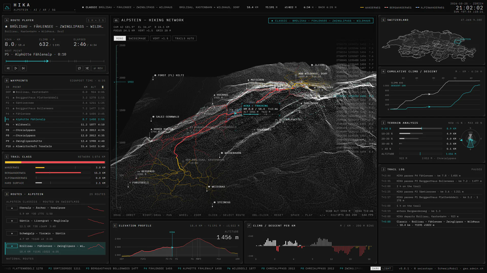
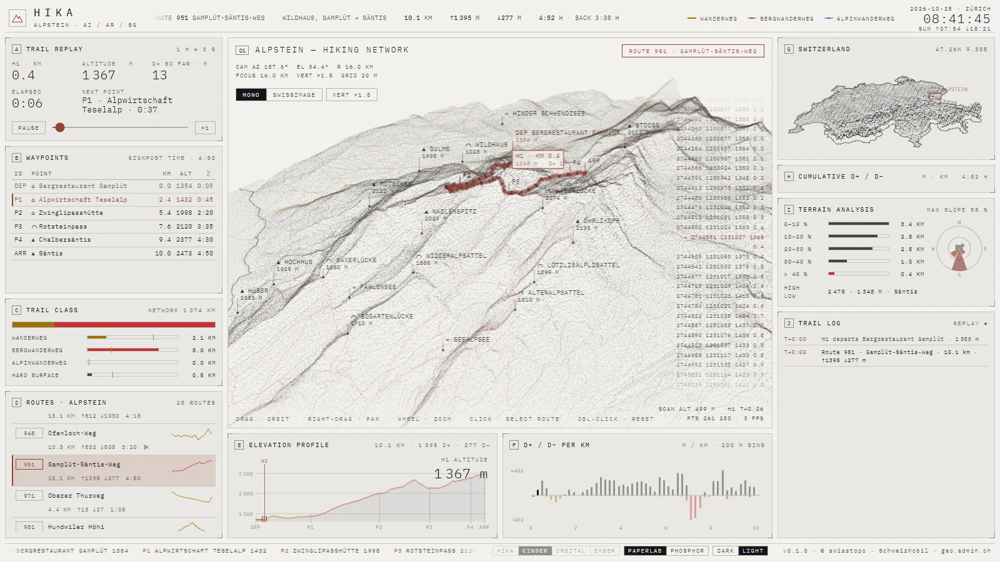

<div align="center">

# HIKA · Swiss trail console

**A sci-fi HUD for exploring Swiss hiking routes, built entirely on swisstopo open data.**

[](https://github.com/SosiNone/hika/actions/workflows/ci.yml)
[](https://github.com/SosiNone/hika/actions/workflows/pages.yml)
[](LICENSE)
[](NOTICE.md)

### [▶ Open the live console](https://sosinone.github.io/hika/)

[](https://sosinone.github.io/hika/#route=c-bruelisau-wildhaus)

</div>

HIKA renders Swiss hiking routes on holographic 3D terrain: 950 SchweizMobil routes and stages
across Switzerland, and 66 curated classics in 29 hand-picked regions, each route with the
signposted trails around it. Pick a route and a hiker walks it at official Swiss signpost pace
while the instruments follow along.

## Features

- **Terrain** from swissALTI3D as a point cloud with contours and adjustable vertical
  exaggeration.
- **Trails** from swissTLM3D in the official signpost colours, with summits, huts, passes and lakes
  from swissNAMES3D.
- **Route player:** scrub, change speed, walk the hike in reverse, or let the region's routes play
  as a playlist with repeat and shuffle.
- **Instruments:** elevation profile, climb and descent, slope and aspect, trail classes, a
  Switzerland locator with lakes and every region, and sunrise and sunset.
- **Region browser and route search:** a map of Switzerland with the regions, their routes, trail
  kilometres and altitude range, and a search over every route in the country.
- **Real hiking times** from a pace table digitised from the official Schweizer Wanderwege chart.
- **Shareable links** for every route, e.g. the
  [Eiger Trail](https://sosinone.github.io/hika/?region=jungfrau#route=sm-353.00).
- **Dark and light schemes,** and no backend: the app reads a static data store, the atlas.
- **Works on phones and tablets,** with touch gestures on the map and the route player right
  under it.

[](https://sosinone.github.io/hika/?scheme=light#route=sm-951.00)

| Input | Action |
|---|---|
| Drag / right-drag / wheel | Orbit / pan / zoom |
| One finger / two fingers / pinch | Orbit / pan / zoom |
| Click or tap / double-click or double tap | Select route / reset camera |
| Hover a route on the map or in the list | Highlight it |
| Drag along the elevation profile | Move the hiker |
| Space | Play / pause |
| G | Region browser |
| ← / → | Previous / next route |

## Regions

[Aletsch](https://sosinone.github.io/hika/?region=aletsch) ·
[Alpes vaudoises](https://sosinone.github.io/hika/?region=alpes-vaudoises) ·
[Alpstein](https://sosinone.github.io/hika/?region=alpstein) ·
[Davos](https://sosinone.github.io/hika/?region=davos) ·
[Engadin](https://sosinone.github.io/hika/?region=engadin) ·
[Engelberg](https://sosinone.github.io/hika/?region=engelberg) ·
[Flims](https://sosinone.github.io/hika/?region=flims) ·
[Glarus](https://sosinone.github.io/hika/?region=glarus) ·
[Jungfrau](https://sosinone.github.io/hika/?region=jungfrau) ·
[Jura](https://sosinone.github.io/hika/?region=jura) ·
[Kandersteg](https://sosinone.github.io/hika/?region=kandersteg) ·
[Lake Lucerne](https://sosinone.github.io/hika/?region=lucerne) ·
[Leventina](https://sosinone.github.io/hika/?region=leventina) ·
[National Park](https://sosinone.github.io/hika/?region=nationalpark) ·
[Verbier](https://sosinone.github.io/hika/?region=verbier) ·
[Verzasca](https://sosinone.github.io/hika/?region=verzasca) ·
[Zermatt](https://sosinone.github.io/hika/?region=zermatt)

Each region is a 24 × 19 km box scored from the national data (mountain trails, huts, summits,
lakes and lifts) and anchored on a well-known hiking area.

## Quick start

Requires Node 24 and [Task](https://taskfile.dev/installation/).

```bash
git clone https://github.com/SosiNone/hika.git
cd hika
task dev
```

The app reads its data, the atlas (see [AGENTS.md](AGENTS.md)), from the published
[hika-data](https://github.com/SosiNone/hika-data) site, so it runs without building any data.
`task` lists every command.

To build the atlas yourself from swisstopo data into `.atlas/v3/`, which `task dev` then serves
(several GB of downloads on the first run, cached in `.cache/`, at the pace geo.admin.ch's
fair-use terms allow):

```bash
task atlas
```

`task check` runs the type-checker and the tests, which is what CI runs before it builds. Releases are deployed to GitHub Pages from a version tag with
`task release BUMP=patch`.

[AGENTS.md](AGENTS.md) covers the architecture, and [docs/data-coverage.md](docs/data-coverage.md)
lists every data source and where the app shows it.

## Credits

The look is inspired by [beastydesign · Diagonale des Fous](https://beastydesign.github.io/scifi/),
a sci-fi race console for La Réunion. Its code is all rights reserved, so HIKA is an independent
re-implementation and copies none of its code or assets. The paperlab greys are ported from
[LosEcher · hud-console-framework](https://github.com/LosEcher/hud-console-framework) (MIT).

## Licence

The code is released under the [MIT licence](LICENSE). The data (in
[hika-data](https://github.com/SosiNone/hika-data)) and the screenshots in `docs/` are not covered
by it: geodata ©swisstopo, hiking routes from Wanderland Schweiz (FEDRO, SchweizMobil and the
cantons). See [NOTICE.md](NOTICE.md); the site ships it, with the font's licence, as `NOTICE.txt`.
