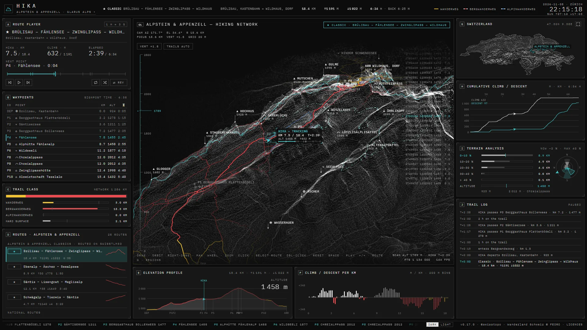
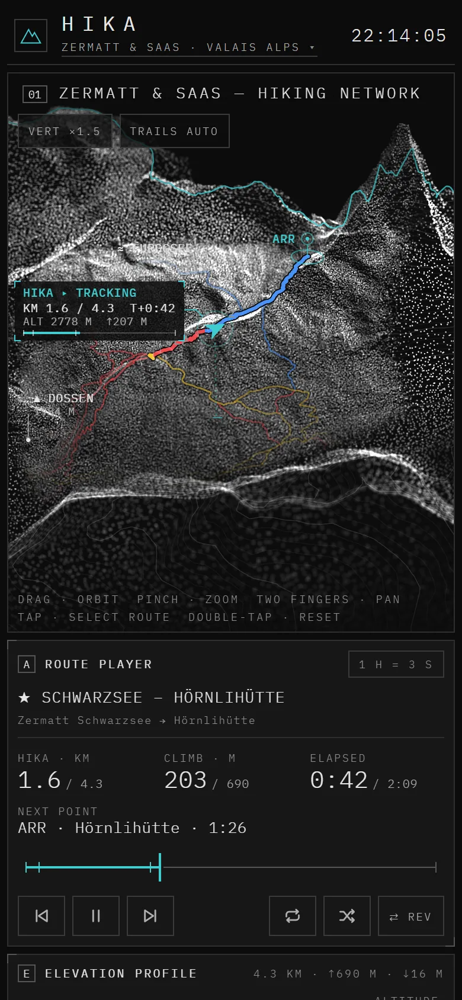
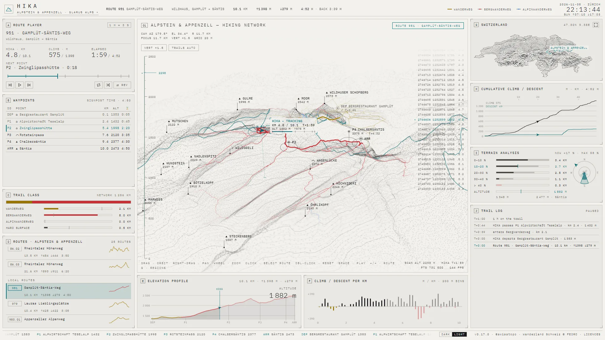
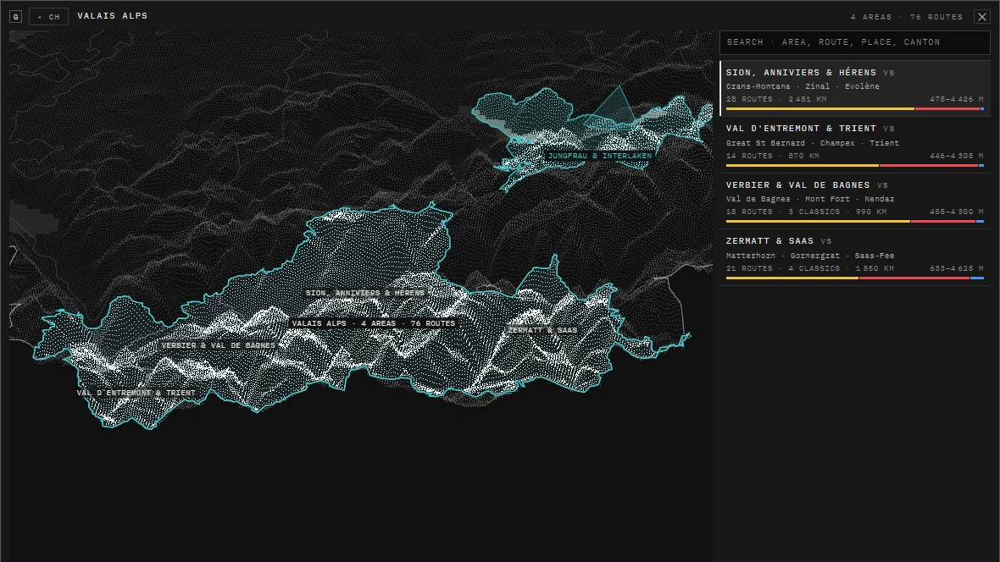
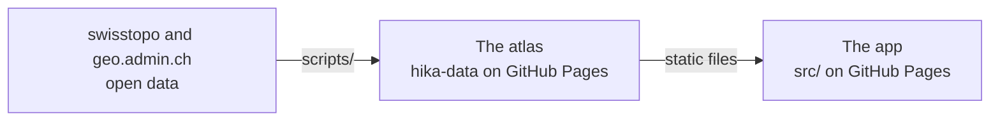

<div align="center">

# HIKA · Swiss trail console

**A sci-fi HUD for exploring Swiss hiking routes, built entirely on swisstopo open data.**

[](https://github.com/SosiNone/hika/actions/workflows/ci.yml)
[](https://github.com/SosiNone/hika/actions/workflows/pages.yml)
[](LICENSE)
[](NOTICE.md)

### [▶ Open the live console](https://sosinone.github.io/hika/)

[](https://sosinone.github.io/hika/#route=c-bruelisau-wildhaus)

</div>

HIKA renders Swiss hiking routes on holographic 3D terrain: 950 SchweizMobil routes and stages and
66 curated classics, in 54 valleys and landscapes across the 10 Swiss mountain ranges, each route
with the signposted trails around it. Pick a route and a hiker walks it at official Swiss signpost
pace while the instruments follow along.

## Features

<a href="https://sosinone.github.io/hika/?region=zermatt#route=c-schwarzsee-hoernlihuette"></a>

- **Terrain** from swissALTI3D as a point cloud with contours and adjustable vertical exaggeration:
  the whole area, with full detail around the selected route and its border on the ridges.
- **Trails** from swissTLM3D in the official signpost colours, with summits, huts, passes and lakes
  from swissNAMES3D.
- **Route player:** scrub, change speed, walk the hike in reverse, or let the area's routes play as
  a playlist with repeat and shuffle.
- **Instruments:** elevation profile, climb and descent, slope and aspect, trail classes, a
  Switzerland locator with lakes and the mountain ranges, and sunrise and sunset.
- **Region browser and route search:** pick a mountain range on a map of Switzerland, zoom into its
  valleys and landscapes with their routes, trail kilometres and altitude range, and search every
  area (in any national language) and every route in the country.
- **Real hiking times** from a pace table digitised from the official Schweizer Wanderwege chart.
- **Shareable links** for every route, e.g. the
  [Eiger Trail](https://sosinone.github.io/hika/?region=jungfrau#route=sm-353.00).
- **Dark and light schemes,** and no backend: the app reads a static data store, the atlas.
- **Works on phones and tablets,** with touch gestures on the map and the route player right under
  it.

<br clear="right">

<table>
  <tr>
    <td width="50%"><a href="https://sosinone.github.io/hika/?scheme=light#route=sm-951.00"></a></td>
    <td width="50%"><a href="https://sosinone.github.io/hika/"></a></td>
  </tr>
  <tr>
    <td align="center"><sub>The light scheme</sub></td>
    <td align="center"><sub>The region browser, zoomed into the Valais Alps</sub></td>
  </tr>
</table>

<sub>Screenshots show geodata ©swisstopo and routes from Wanderland Schweiz © FEDRO.</sub>

## Controls

| Action | Mouse and keyboard | Touch |
|---|---|---|
| Orbit | Drag | One finger |
| Pan | Right-drag | Two fingers |
| Zoom | Wheel | Pinch |
| Select a route | Click | Tap |
| Reset the camera | Double-click | Double tap |
| Highlight a route | Hover it on the map or in the list | |
| Move the hiker | Drag along the elevation profile | Drag along the elevation profile |
| Play / pause | Space | Route player |
| Previous / next route | ← / → | Route player |
| Region browser | G | Area name in the top bar |

## Ranges and areas

The ranges are swisstopo's ten Grossregionen. The areas tile the country: each grows from official
swisstopo outlines of a landscape or valley over the terrain by Swiss hiking time, so their borders
fall on ridges and lakes, and every route belongs to the area that holds most of it.

<details>
<summary><strong>All 54 areas, by range</strong></summary>
<br>

| Range | Areas |
|---|---|
| **Jura** | [Ajoie & Franches-Montagnes](https://sosinone.github.io/hika/?region=ajoie) · [Baselbiet](https://sosinone.github.io/hika/?region=baselbiet) · [Chasseral](https://sosinone.github.io/hika/?region=chasseral) · [Creux du Van & Val-de-Travers](https://sosinone.github.io/hika/?region=val-de-travers) · [Delémont & Weissenstein](https://sosinone.github.io/hika/?region=delemont) · [Vallée de Joux](https://sosinone.github.io/hika/?region=vallee-de-joux) |
| **Swiss Plateau** | [Aargau](https://sosinone.github.io/hika/?region=aargau) · [Bern & Aare Valley](https://sosinone.github.io/hika/?region=bern) · [Emmental](https://sosinone.github.io/hika/?region=emmental) · [Entlebuch & Napf](https://sosinone.github.io/hika/?region=entlebuch) · [Geneva & La Côte](https://sosinone.github.io/hika/?region=geneve) · [Lake Lucerne](https://sosinone.github.io/hika/?region=lucerne) · [Lake Zurich & Einsiedeln](https://sosinone.github.io/hika/?region=lake-zurich) · [Lausanne & Lavaux](https://sosinone.github.io/hika/?region=lausanne) · [Schaffhausen & Weinland](https://sosinone.github.io/hika/?region=schaffhausen) · [Three Lakes](https://sosinone.github.io/hika/?region=seeland) · [Thurgau & Fürstenland](https://sosinone.github.io/hika/?region=thurgau) · [Toggenburg](https://sosinone.github.io/hika/?region=toggenburg) · [Zürcher Oberland](https://sosinone.github.io/hika/?region=zurcher-oberland) · [Zurich & Albis](https://sosinone.github.io/hika/?region=zurich) |
| **Prealps** | [Gruyère & Schwarzsee](https://sosinone.github.io/hika/?region=gruyere) · [Pays-d'Enhaut & Saanenland](https://sosinone.github.io/hika/?region=pays-d-enhaut) · [Simmental & Diemtigtal](https://sosinone.github.io/hika/?region=simmental) |
| **Vaud Alps** | [Alpes vaudoises & Chablais](https://sosinone.github.io/hika/?region=alpes-vaudoises) |
| **Bernese Alps** | [Aletsch & Brig](https://sosinone.github.io/hika/?region=aletsch) · [Jungfrau & Interlaken](https://sosinone.github.io/hika/?region=jungfrau) · [Kandersteg & Adelboden](https://sosinone.github.io/hika/?region=kandersteg) |
| **Valais Alps** | [Sion, Anniviers & Hérens](https://sosinone.github.io/hika/?region=sion) · [Val d'Entremont & Trient](https://sosinone.github.io/hika/?region=entremont) · [Verbier & Val de Bagnes](https://sosinone.github.io/hika/?region=verbier) · [Zermatt & Saas](https://sosinone.github.io/hika/?region=zermatt) |
| **Uri Alps** | [Engelberg & Titlis](https://sosinone.github.io/hika/?region=engelberg) · [Haslital & Hasliberg](https://sosinone.github.io/hika/?region=haslital) · [Uri & Maderanertal](https://sosinone.github.io/hika/?region=uri) |
| **Glarus Alps** | [Alpstein & Appenzell](https://sosinone.github.io/hika/?region=alpstein) · [Flims & Laax](https://sosinone.github.io/hika/?region=flims) · [Glarnerland](https://sosinone.github.io/hika/?region=glarus) · [Sarganserland & Walensee](https://sosinone.github.io/hika/?region=sarganserland) · [Schwyz & Muotatal](https://sosinone.github.io/hika/?region=schwyz) |
| **Lepontine Alps** | [Bellinzona & Mesolcina](https://sosinone.github.io/hika/?region=bellinzona) · [Goms & Binntal](https://sosinone.github.io/hika/?region=goms) · [Gotthard](https://sosinone.github.io/hika/?region=gotthard) · [Leventina & Blenio](https://sosinone.github.io/hika/?region=leventina) · [Locarno, Maggia & Verzasca](https://sosinone.github.io/hika/?region=verzasca) · [Lugano](https://sosinone.github.io/hika/?region=lugano) · [Surselva](https://sosinone.github.io/hika/?region=surselva) · [Vals & Rheinwald](https://sosinone.github.io/hika/?region=vals) |
| **Rhaetian Alps** | [Chur, Arosa & Lenzerheide](https://sosinone.github.io/hika/?region=arosa) · [Davos & Albula](https://sosinone.github.io/hika/?region=davos) · [Lower Engadine & National Park](https://sosinone.github.io/hika/?region=nationalpark) · [Prättigau & Bündner Herrschaft](https://sosinone.github.io/hika/?region=prattigau) · [Upper Engadine & Bregaglia](https://sosinone.github.io/hika/?region=engadin) · [Valposchiavo](https://sosinone.github.io/hika/?region=valposchiavo) · [Viamala & Surses](https://sosinone.github.io/hika/?region=viamala) |

</details>

## Quick start

Requires Node 24 and [Task](https://taskfile.dev/installation/).

```bash
git clone https://github.com/SosiNone/hika.git
cd hika
task dev
```

The app reads its data from the published [hika-data](https://github.com/SosiNone/hika-data) site,
so it runs without building any.

| Command | What it does |
|---|---|
| `task` | Lists every command |
| `task dev` | Runs the app locally |
| `task check` | Type-checks and runs the tests, which is what CI runs before it builds |
| `task build`, `task preview` | Builds the site into `dist/`, and serves that build |
| `task atlas` | Builds and validates the data from swisstopo sources in `.atlas/v4/`, which `task dev` then serves |
| `task regions:preview` | Cuts Switzerland into the areas of `regions/` and draws a map of them, from the download cache |
| `task release BUMP=patch` | Bumps the version and pushes the tag, which deploys the site to GitHub Pages |

A first `task atlas` takes about 1.5 hours: several GB of downloads, cached in `.cache/`, at the
pace geo.admin.ch's fair-use terms allow.

## How it works

HIKA has no backend. A build-time pipeline turns the open data into a static data store, the
**atlas**, and the browser app only ever reads that, one window of terrain at a time.



| Path | What's in it |
|---|---|
| [`src/`](src) | The browser app: WebGL2 terrain, HUD panels and the region browser, with no UI framework |
| [`scripts/`](scripts) | The pipeline that builds and validates the atlas |
| [`regions/`](regions) | One config per area: where it grows from, and its curated hikes |
| [`test/`](test) | Unit tests, run with Vitest |
| [hika-data](https://github.com/SosiNone/hika-data) | The built atlas, in a repository of its own, so data refreshes ship without an app release |

[AGENTS.md](AGENTS.md) covers the architecture in depth, and
[docs/data-coverage.md](docs/data-coverage.md) lists every data source and where the app shows it.

## Credits

The look is inspired by [beastydesign · Diagonale des Fous](https://beastydesign.github.io/scifi/),
a sci-fi race console for La Réunion. Its code is all rights reserved, so HIKA is an independent
re-implementation and copies none of its code or assets. The paperlab greys are ported from
[LosEcher · hud-console-framework](https://github.com/LosEcher/hud-console-framework) (MIT).

## Licence

The code is released under the [MIT licence](LICENSE). The data (in
[hika-data](https://github.com/SosiNone/hika-data)) and the screenshots in `docs/` are not covered
by it: geodata ©swisstopo, hiking routes from Wanderland Schweiz (FEDRO, SchweizMobil and the
cantons). See [NOTICE.md](NOTICE.md); the site ships it, with the font's licence, as `NOTICE.txt`.
